# 🎉 Etkinlik Yönetim - Event Management System (C# & SQL Server)

🇬🇧 **English** · 🇹🇷 [Türkçe](README.tr.md)

A Windows Forms application built with .NET 10 and SQL Server for running events: accounts sign up and sign in,
add the participants they bring, register them for events (or join the waiting list of a full event) and get a
ticket with a QR code for each seat; admins create, change and cancel events, check tickets in at the entrance,
list and export the participants of an event and manage the accounts. The code is split into Domain, Business,
Data and UI layers; database access uses EF Core, and the database is created and migrated automatically on
startup.

> The application's user interface is in Turkish. Screen and button names below are given with their Turkish
> labels followed by an English translation, e.g. "Etkinliği ekle" (Add event).

---

## 📦 Features

### Accounts

- ✅ **Sign-up** ("Kayıt ol", Sign up): a user name of letters only (at most 32 characters) and a password of
  8-64 characters, typed twice ("Şifre tekrar", Password again). New accounts get the user role.
- ✅ **Sign-in** ("Giriş yap", Sign in) with the user name and the password ("Kullanıcı adı", "Şifre"). Admins open
  the admin panel, users the participant screen.
- ✅ **Sign-out** ("Oturumu kapat", Sign out) on the admin panel and on a user's main screen returns to the
  sign-in, which says why the session ended; closing the window ends the application.
- ✅ **First-run setup** ("İlk kurulum", First-run setup): on an empty database the first admin is created with a
  password of the installer's own choosing; there is no default account and no published password.

### User panel

- ✅ **Add a participant** ("Katılımcı ekle", Add participant): national identity number ("T.C. kimlik no"), full name
  ("Ad soyad") and e-mail ("E-posta"). The national id is checked for 11 digits and its checksum; the name may
  contain letters and single spaces (at most 64 characters). A participant belongs to the account that added it,
  and a national id can be added only once per account.
- ✅ **Register for an event** ("Kayıtlar ve biletler", Registrations and tickets): choose an event that has not passed
  ("Etkinlik", Event) and enter the participant's national id ("Katılımcının T.C. kimlik no"). A ticket code
  of 130 random bits (`ETK-` and 26 characters) is issued with every seat. A participant can be registered for
  several events.
- ✅ **Waiting list**: when an event is full the participant joins its waiting list with a queue number instead
  of being refused. When a seat is cancelled, the first one waiting moves up to it at once and gets a ticket.
- ✅ **My registrations and tickets** ("Kayıtlarım", My registrations): the seats and
  waiting places of the account's own participants, and registrations closed because their event was cancelled
  ("Etkinlik iptal edildi", Event cancelled). Seats and waiting places can be cancelled ("Kaydı iptal et", Cancel
  registration) up to and including the event day, unless the ticket has already been scanned at the entrance.
- ✅ **Show the ticket** ("Bileti göster", Show ticket): the QR code and the code of a seat, as often as needed.

### Admin panel

- ✅ **Create an event** ("Etkinliği ekle", Add event): name ("Etkinlik adı", at most 80 characters), date (today or
  later) and capacity ("Kapasite", 1-1000 seats).
- ✅ **Event management** ("Etkinlik yönetimi", Event management): change the date, capacity and description of an
  event that has not passed; the capacity cannot go below the seats held, and added seats go to the waiting list.
  A save over another admin's change made after the form was loaded is refused and the current values are shown
  (an edit version decides, so also a change of only the case of the description is noticed). Which events can
  still be changed follows the database's day, not the computer's clock.
  Cancelling an event ("Etkinliği iptal et", Cancel event) keeps it listed as cancelled and closes its
  registrations and waiting places (soft delete).
- ✅ **Add participants** ("Katılımcı ekle") and **issue tickets** ("Kayıt ve bilet", Registration and ticket) for the
  participants of every account; an admin sees and cancels every registration, but sees the ticket codes only of
  the participants it added.
- ✅ **Entrance check-in** ("Giriş kontrolü", Entrance check): choose the event and type or scan ticket codes. A valid
  unused ticket is checked in ("GİRİŞ YAPILDI"), a second scan says "ZATEN KULLANILDI" (already used) on the same
  screen, and unknown or cancelled tickets and those of other events get one refusal ("GEÇERSİZ BİLET"); a counter
  shows the check-ins against the seats. A check-in shows the participant's name to compare with an identity
  document, tickets are used only on the event's day, decided again under the event's lock when the ticket is
  written ("ETKİNLİK GÜNÜ DEĞİL" otherwise, and the ticket stays valid), and the code field stays open so a scanner
  can read the next ticket while one is being checked.
- ✅ **Participant list** ("Katılımcı listesi", Participant list): the participants of a chosen event ("Etkinlik",
  Event) with name, masked national id, e-mail and state (checked in, waiting, cancelled), saved as
  CSV ("CSV olarak kaydet") or as a printable HTML page ("Yazdırılabilir liste"). Exports contain no ticket codes.
- ✅ **Accounts** ("Hesaplar", Accounts): enable or disable accounts and make them admins or users. An admin
  cannot change their own account, and the last enabled admin is kept.

### Rules and protection

- ✅ **Capacity**: an event never takes more registrations than its capacity; the seat count is checked and
  increased in the same database transaction, under an application lock per event, so concurrent registrations,
  cancellations and capacity changes cannot overbook it or let anyone pass the waiting list. A participant who has
  been checked in keeps the seat: the registration can no longer be cancelled, and the entrance takes the same lock,
  so the room never holds more people than the event has seats.
- ✅ **No duplicate registration**: a participant has at most one seat or waiting place per event (unique index);
  a cancelled registration stays as history.
- ✅ **No past events**: events cannot be created, registered for or cancelled once their day has passed. "Today"
  comes from the database's clock, not the computer's, read inside the writing transaction after its lock, and so
  do the times written for registrations, cancellations and check-ins.
- ✅ **KVKK**: national ids are shown masked (`123******01`) in admin lists and never written to log files; names and
  e-mail addresses are shown in full in the admin participant list.

### Security

- ✅ Passwords are stored as PBKDF2-HMAC-SHA256 hashes (600,000 iterations, random salt); plain text passwords of
  the original application are replaced with a hash on the next successful sign-in.
- ✅ 5 failed sign-ins lock the account for 15 minutes; unknown accounts, wrong passwords and locked accounts get
  the same answer.
- ✅ Every call is checked against the signed-in session and the session against the database: a demoted,
  disabled or deleted account cannot use a window that is still open, and such a window stays closed when the
  account is enabled or promoted again (a session version changes with every change of access). Every write checks
  its account again inside its own transaction, after its lock, so an account disabled while the write waited
  writes nothing. Users reach only their own participants and registrations, and a missing record and somebody
  else's record get the same answer.
- ✅ Ticket codes are compared in constant time after a lookup by their SHA-256; they are never logged or exported.
- ✅ Central FluentValidation validators with Turkish messages; write buttons ignore repeated clicks while an
  operation is pending.
- ✅ Daily log files without personal data, with anonymous audit codes; outcomes that would tell whether an account,
  a registration or a ticket exists share one neutral code.

---

## 🖼️ Screenshots

The screens are drawn offscreen from an invented event season (made-up people and accounts, example.com addresses,
masked national ids and a visibly sample ticket code), so they show no real data. Each image links to its 2x
version. To draw them again: `dotnet run --project tools/Screenshots -c Release -- screenshots`.

| | |
|---|---|
| [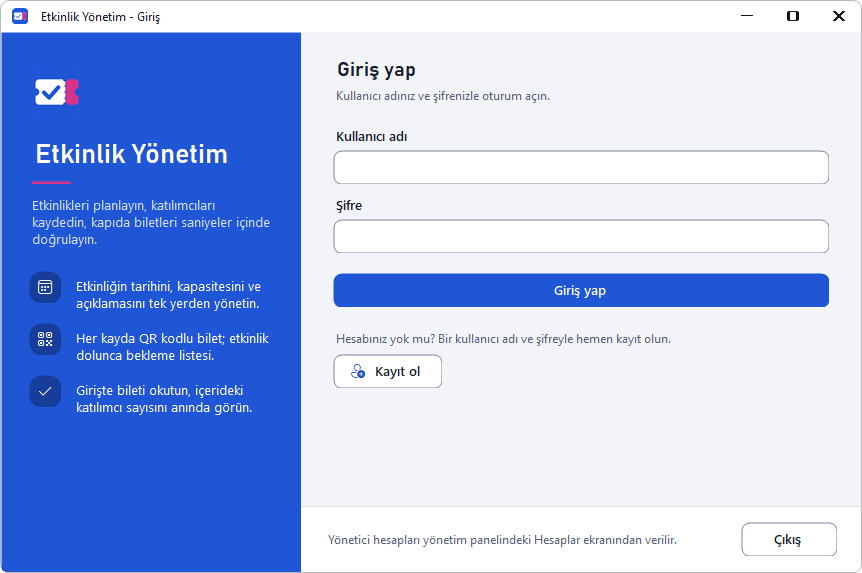](screenshots/giris-2x.png)<br>**Sign-in** ("Giriş yap") with the brand panel | [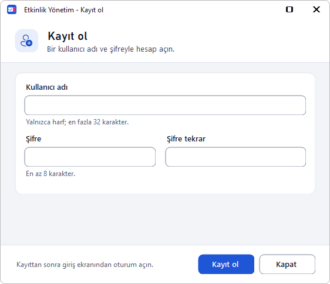](screenshots/kayit-ol-2x.png)<br>**Sign-up** ("Kayıt ol") |
| [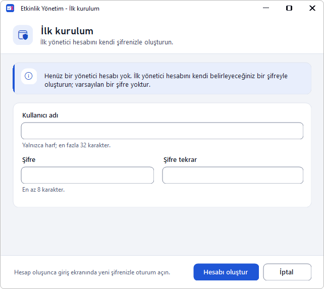](screenshots/ilk-kurulum-2x.png)<br>**First-run setup** ("İlk kurulum") on an empty database | [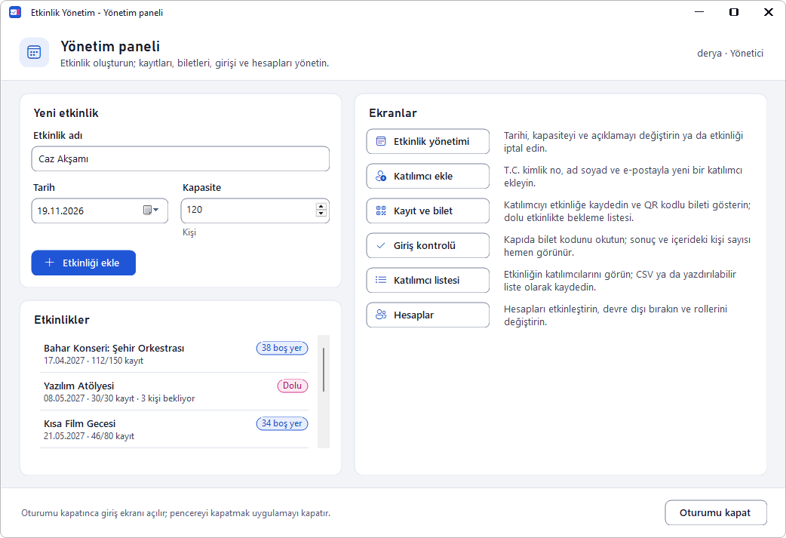](screenshots/yonetim-paneli-2x.png)<br>**Admin panel** ("Yönetim paneli"): a new event, the season with its seats, shortcuts |
| [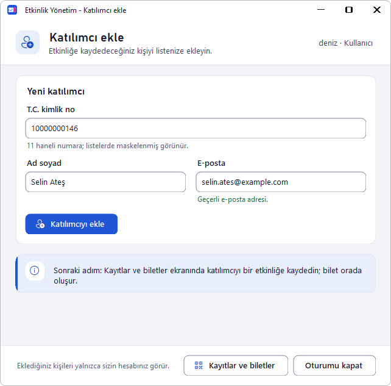](screenshots/katilimci-ekle-2x.png)<br>**Add participant** ("Katılımcı ekle"), the main screen of a user | [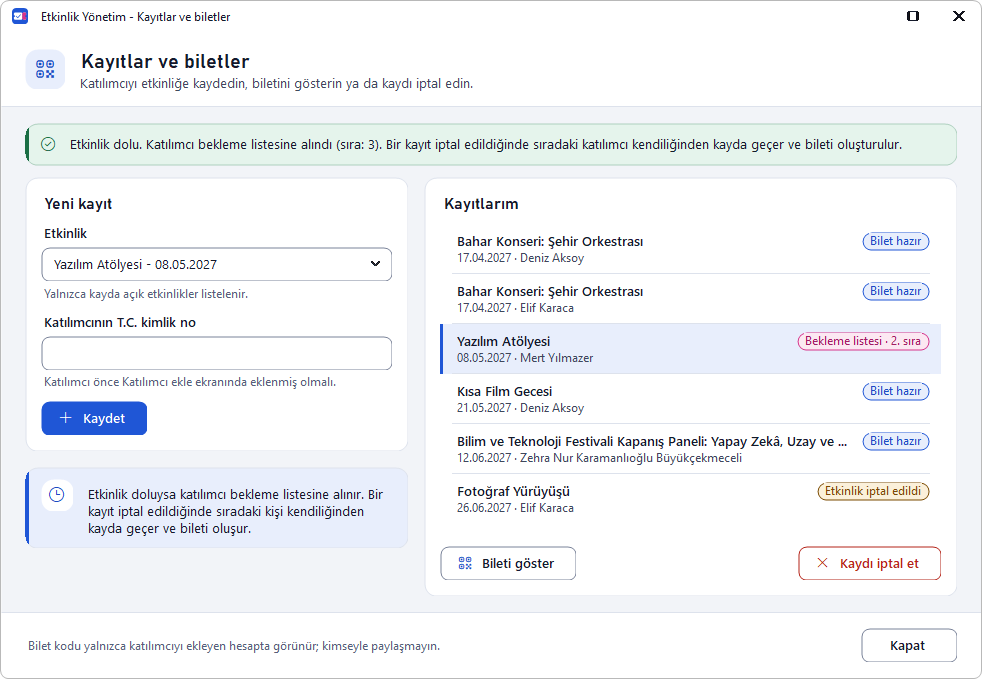](screenshots/kayitlar-ve-biletler-2x.png)<br>**Registrations and tickets** ("Kayıtlar ve biletler") after a place on the waiting list |
| [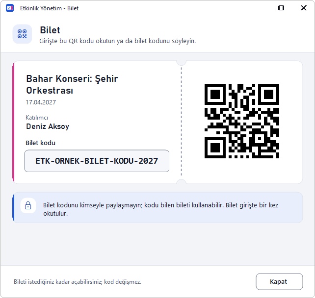](screenshots/bilet-2x.png)<br>**Ticket** ("Bilet") with its QR code | [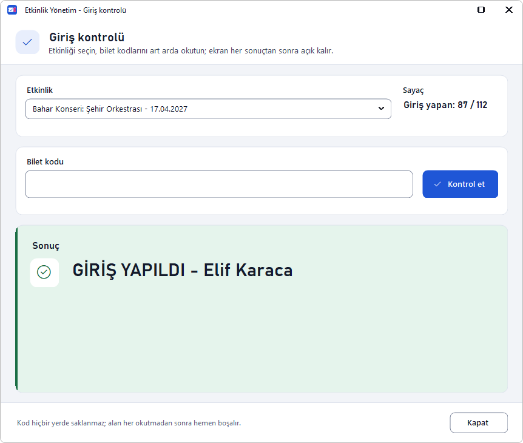](screenshots/giris-kontrolu-2x.png)<br>**Entrance check-in** ("Giriş kontrolü") right after a scan |
| [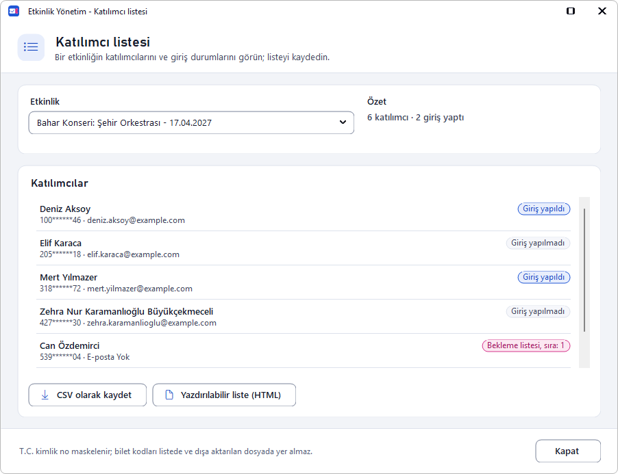](screenshots/katilimci-listesi-2x.png)<br>**Participant list** ("Katılımcı listesi") with CSV and HTML export | [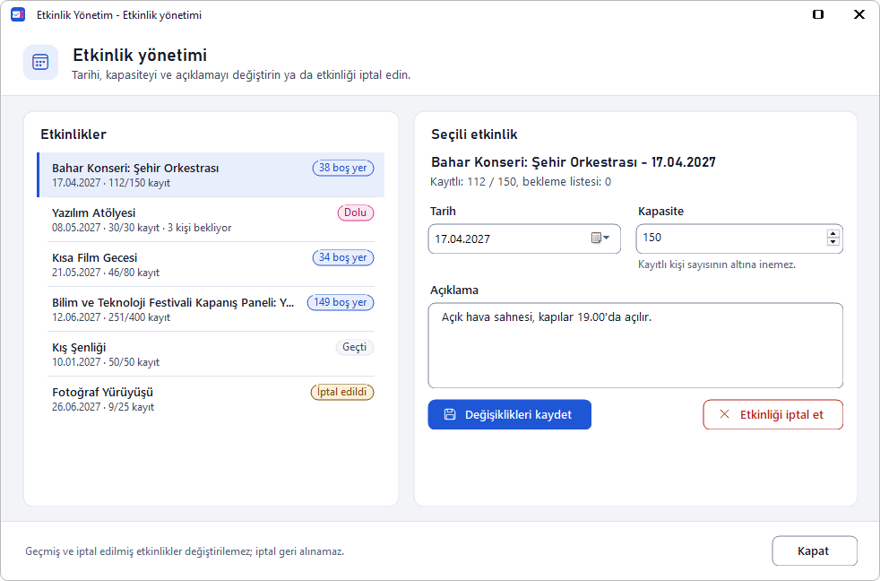](screenshots/etkinlik-yonetimi-2x.png)<br>**Event management** ("Etkinlik yönetimi") |
| [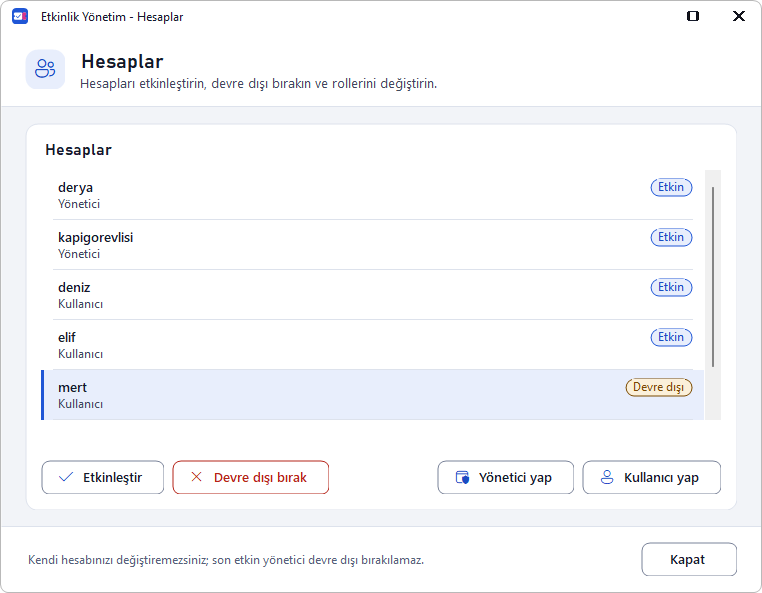](screenshots/hesaplar-2x.png)<br>**Accounts** ("Hesaplar") | [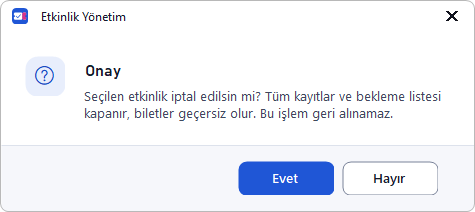](screenshots/onay-penceresi-2x.png)<br>**Confirmation** ("Onay") before an event is cancelled |

### Design

- **Identity:** an original logo (an admission ticket with a magenta stub and a check mark on a cobalt tile,
  `assets/logo.svg`), a cobalt accent with a magenta spotlight mark on cool ink-grey neutrals, Bahnschrift SemiBold
  headings (Segoe UI Semibold where it is missing) and Segoe UI body text. No third-party brand is used.
- **Themes:** light (default), dark and Windows high contrast. `Appearance:Theme` in `appsettings.json` takes
  `Light`, `Dark` or `System` (follows the Windows app mode); high contrast always wins and uses the system colours.
  Open windows follow a change of the contrast or app mode while the application runs.
- **Layout:** every screen shares one frame (header, inline message strip, scrolling body, footer with the actions),
  is per-monitor DPI aware and opens no larger than the working area of its screen. Results and rule refusals are
  shown inside the window; only questions open a themed message window.

---
## 🔑 Permission Matrix

| Action | User | Admin |
|---|---|---|
| Sign up an account | ✅ (from the sign-in screen, user role) | ❌ (the first admin comes from the setup) |
| Sign in | ✅ | ✅ |
| List events | ✅ | ✅ |
| Create an event | ❌ | ✅ |
| Change or cancel an event (not past) | ❌ | ✅ |
| Add a participant | ✅ owned by their account | ✅ owned by their account |
| Register a participant for an event (or its waiting list) | ✅ their own participants only | ✅ any participant |
| List registrations and waiting places | ✅ of their own participants | ✅ all |
| See a ticket code and its QR code | ✅ of their own participants | ✅ of the participants they added |
| Cancel a registration or waiting place | ✅ their own, up to the event day | ✅ any, up to the event day |
| List the participants of an event (masked national id) | ❌ | ✅ |
| Export the participant list (CSV, HTML; no ticket codes) | ❌ | ✅ |
| Check tickets in at the entrance | ❌ | ✅ |
| Enable, disable or change the role of another account | ❌ (not even their own) | ✅ (not their own; the last enabled admin stays) |
| Create the first admin | ❌ (empty database, or with the owner's setup key only) | - |

---

## 🧰 Tech Stack

| Area | Used |
|---|---|
| Platform | .NET 10 (`net10.0-windows` UI, `net10.0` libraries) |
| UI | Windows Forms, own theming (light, dark, high contrast), per-monitor DPI |
| Data access | Entity Framework Core 10 (SQL Server provider) |
| Database | Microsoft SQL Server (Express is enough) |
| Password hashing | PBKDF2-HMAC-SHA256 (`Rfc2898DeriveBytes.Pbkdf2`) |
| Validation | FluentValidation |
| QR codes | QRCoder 1.6.0 (MIT) |
| Configuration / DI | Microsoft.Extensions.Configuration (JSON, user secrets, environment), Microsoft.Extensions.DependencyInjection |
| Logging | Serilog (file sink, daily rolling) |
| Testing | xUnit v3, Moq, EF Core SQLite (in-memory), real SQL Server tests |
| CI | GitHub Actions (`.github/workflows/ci.yml`) |

---

## 🗂️ Project Structure

```text
EtkinlikYonetim/
├── src/
│   ├── EtkinlikYonetim.Domain/     # Entities (User, Event, Participant, Registration, SetupKey) and repository contracts
│   ├── EtkinlikYonetim.Business/   # Auth, setup, account, event, participant, registration and check-in services, Exports/ (CSV, HTML), Security/ (PBKDF2, lockout, setup keys), Validation/ (FluentValidation), Auditing/
│   ├── EtkinlikYonetim.Data/       # EF Core DbContext, configurations, Migrations/, legacy upgrade, demo data, repositories
│   └── EtkinlikYonetim.UI/         # WinForms screens, Theming/ (palettes, type ramp, painted controls, theme watcher), Infrastructure/ (screen frame, layout, message dialog, errors, logging, write guard, session end, QR codes, export files), Program.cs (composition root)
├── tests/
│   ├── EtkinlikYonetim.Business.Tests/  # Validators, national id, hashing, lockout, capacity, dates and ownership (Moq)
│   ├── EtkinlikYonetim.Data.Tests/      # Services on SQLite; races, setup keys and the legacy upgrade on SQL Server
│   └── EtkinlikYonetim.UI.Tests/        # Screens, layout on small screens and with large text, themes, configuration, errors, logs, focus and write guards (no windows shown)
├── assets/                         # Original logo (logo.svg) with the icon and PNG rasterized from it
├── tools/Screenshots/              # Offscreen screenshots and the icon tool (no window is shown)
├── docs/
│   ├── issue-setup-key.sql         # Setup key, run by the database owner
│   ├── grant-app-login.sql         # Rights of the application's own login
│   └── THREAT_MODEL.md             # Threat model
├── screenshots/
├── .github/workflows/ci.yml        # Build, test, SQL Server and release workflow
├── CHANGELOG.md
└── EtkinlikYonetim.sln
```

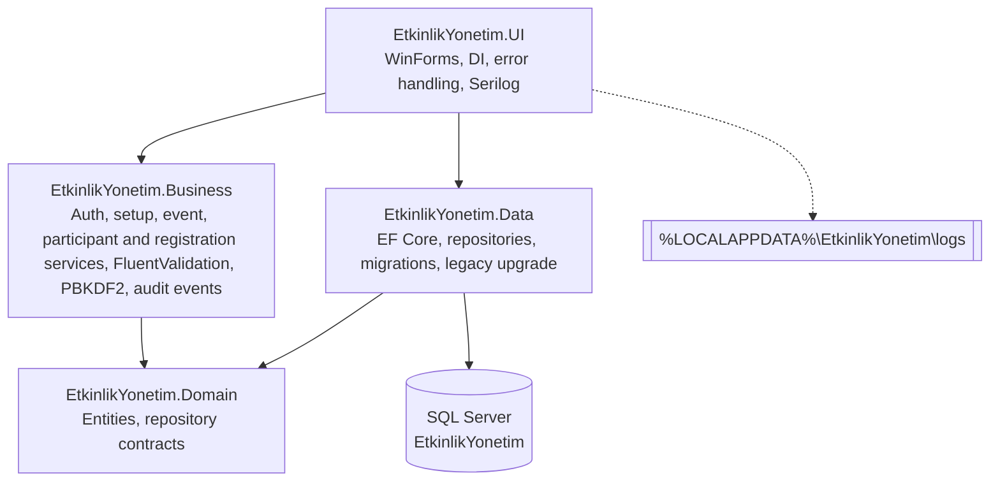

The UI references Data only to register dependencies at startup; forms work through the Business services, which
take the signed-in session on every call. All database access is asynchronous and parameterised. The provider is
configured through DI (`AddDataAccess`), so tests can use SQLite in-memory.

---

## 🛠️ Setup and Usage

### Requirements

- .NET 10 SDK (Windows)
- SQL Server (Express is enough)

```powershell
git clone https://github.com/ayberkaarda/EtkinlikYonetim.git
cd EtkinlikYonetim
dotnet build -c Release
```

### 1. Configuration

Provide a connection string named `EtkinlikYonetim`. Any of the following works (later ones override earlier ones):

1. **`appsettings.json`**: copy `src/EtkinlikYonetim.UI/appsettings.example.json` to `appsettings.json` in the
   same folder and edit `ConnectionStrings:EtkinlikYonetim`. `appsettings.json` is git-ignored.

   ```json
   {
     "ConnectionStrings": {
       "EtkinlikYonetim": "Server=localhost\\SQLEXPRESS;Database=EtkinlikYonetim;Trusted_Connection=True;TrustServerCertificate=True;"
     },
     "Seed": {
       "Demo": false
     },
     "Appearance": {
       "Theme": "Light"
     }
   }
   ```

   `Appearance:Theme` is `Light` (default), `Dark` or `System`; Windows high contrast always takes precedence.

2. **User secrets**:

   ```powershell
   dotnet user-secrets set "ConnectionStrings:EtkinlikYonetim" "<connection string>" --project src/EtkinlikYonetim.UI
   ```

3. **Environment variable** `ConnectionStrings__EtkinlikYonetim`.
4. **Environment variable** `ETKINLIK_CONNECTION` (highest priority).

> Inside JSON the `\` in `localhost\SQLEXPRESS` is written as `\\`. `TrustServerCertificate=True` is meant for a
> local development server only.

If no connection string is found, the application shows a Turkish message explaining these options and exits.

### 2. Running

```powershell
dotnet run --project src/EtkinlikYonetim.UI
```

You do not need to create tables by hand: the database is created on first start and pending EF Core migrations
are applied automatically on every start, so no manual `dotnet ef database update` and no `.bak` file are needed.

### 3. First-run setup

- **Empty database (no account at all):** the default installation creates no account and contains no ready-made
  password. The **"İlk Kurulum"** (First-Run Setup) screen opens and you create the first admin account with a
  password of your own choosing. No key is needed. Closing the setup ends the application.
- **Database with accounts but no admin** (for example an upgraded old database): the application opens with the
  normal sign-in; a missing admin alone gives nobody any rights. The first admin can be created only with a
  **setup key**: the **"İlk yönetici hesabını oluştur"** (Create the first admin account) link on the sign-in screen
  opens the setup form, which asks for the key.
- The application never creates keys. Only the **database owner** (db_owner or sysadmin) runs
  `docs/issue-setup-key.sql` connected to the application's database, for example
  `sqlcmd -S <server> -d <database> -E -i docs\issue-setup-key.sql`. The script makes a 32 hexadecimal character
  key from 16 random bytes (128 bits, `CRYPT_GEN_RANDOM`), stores only its SHA-256 hash in the `KurulumAnahtarlari`
  table and shows the key once. Give the key to the founder over a safe channel; it is stored nowhere else and the
  application never logs it.
- The script refuses to create a key when the database already has an admin account. To revoke unused keys that
  were lost or seen by someone else, set `@RevokeUnusedKeys` to `1` in the script and run it again.
- `docs/grant-app-login.sql` gives the application's own login example rights: on the key table only reading
  (`SELECT`) and marking a key used (`UPDATE` of the `Tuketildi` and `TuketimTarihi` columns); it cannot add,
  delete, or change the hash or the expiry of a key. On the other tables it may read, insert and update, but never
  delete. Do the first start (schema creation or upgrade) with the database owner's connection, then point the
  application's connection string at this login.
- Type the key into the **"Kurulum Anahtarı"** (Setup Key) field of the form (dashes, spaces and letter case do not
  matter) or provide it with the `ETKINLIK_SETUP_KEY` environment variable; the variable only fills in the field,
  and when it is not a well-formed key the field is left empty with a warning. The value is always checked against
  the database record; a value chosen or generated on the client is never an authority.
- A key is valid for 24 hours and works once: it is marked used in the database together with the write that
  creates the admin account, so it cannot be reused from another profile or computer; if that write fails the key
  is not spent. The expiry is decided by the database's clock at the moment the key is used, not by the computer's
  clock. Once an admin exists, unused keys are refused too. Wrong attempts are not counted and do not revoke the
  key (a 128-bit key cannot be guessed); every wrong attempt is followed by a 1 second pause.

### 4. Demo mode

Demo mode is optional and off by default. The environment variable `ETKINLIK_DEMO=1` (or `true`), or
`"Seed": { "Demo": true }` in `appsettings.json`, adds fictional sample data only to a completely empty database.
Only with demo mode on are these accounts created:

| Role | User name (demo mode only) | Password (demo mode only) |
|---|---|---|
| Admin | `admin` | `Demo.Admin1` |
| User | `ornek` | `Demo.Kullanici1` |

Never switch demo mode on for a real installation.

### 5. Upgrading an existing database

A database created by the original application (tables `Kullanicilar`, `Etkinlikler` and `Katilimcilar` without a
migrations history) is upgraded in place on first start, keeping its data: existing rows, identity values and
plain text passwords are kept; the passwords are marked as legacy plain text and hashed on each account's next
successful sign-in. A participant's single event, stored by name in the original application, becomes an active
registration with a ticket, and the events' seat counters are filled in. The upgrade runs in one transaction under
an application lock (`sp_getapplock`) and is safe to repeat. When existing rows break the new rules, it stops
before changing anything; the application shows a general error message and the log file records the failure only
as exception types and numeric error codes, without the rows or their contents.

Take a backup of the database before the first start with the new version and keep it protected: it still
contains the plain text passwords.

### 6. Migrations

```powershell
dotnet tool restore
dotnet ef migrations list --project src/EtkinlikYonetim.Data
dotnet ef migrations add <Name> --project src/EtkinlikYonetim.Data --output-dir Persistence/Migrations
```

The design-time factory reads `ETKINLIK_CONNECTION` and otherwise uses a local SQL Server Express instance. Apply
new migrations with the database owner's connection; the application's restricted login has no DDL rights.

> **Rollback note:** the `ScopeNationalIdToOwner` migration cannot be rolled back without loss. When participants
> of different accounts share a national id, the rollback stops without changing anything; resolve those rows by
> hand first.

### 7. Logs

Logs are written to `%LOCALAPPDATA%\EtkinlikYonetim\logs`, one file per day. Files older than 30 days are deleted,
and at most 30 files are kept. The folder is outside the repository. Error entries contain only exception types,
HResult codes and the method names of the stack trace (no file paths); refused operations write nothing of their
own. Audit entries are a fixed code and a role only, never an account; every failed sign-in (unknown account,
wrong password, locked or disabled account) writes the same code, `auth.sign_in.failed`. The outcomes that would
tell whether an account, a registration or a ticket exists share one code: `auth.account.registration_submitted`
for a sign-up, `registration.submitted` for a registration, `registration.cancel_submitted` for a cancellation and
`ticket.check_in_submitted` for a scan at the entrance.

Names, e-mail addresses, national ids, passwords, setup keys, ticket codes and exception messages are never written
to the log.

---

## 🔐 Security

See [docs/THREAT_MODEL.md](docs/THREAT_MODEL.md) for the threat model.

- National ids, names and e-mail addresses are personal data (KVKK). They are stored only in the configured SQL
  Server database and never written to log files. National ids are shown masked in admin lists; names and e-mail
  addresses are shown in full in the admin participant list.
- Passwords are hashed with PBKDF2; the stored format is kept in its own column, so a value is never read in
  another format.
- Lockout counters are updated atomically, and a successful sign-in is written only while the account is still
  unlocked, so concurrent attempts cannot clear a fresh lock.
- Ownership is checked in the services and repeated in the database statements.
- Every operation of an open session reads the account's role, enabled state and session version from the database
  first, and every write checks the acting account (id, role, session version) again inside its own transaction,
  after its lock, keeping the account row locked until the commit on SQL Server; account changes take the accounts
  lock first, then check the acting admin in the same way.
- Ticket codes have 130 random bits (128 for tickets reissued by the upgrade). They are stored as they are, so the participant's account can show the QR
  code again, together with their SHA-256: the entrance finds a ticket by the hash and compares the code in
  constant time. Admin lists and exports never show them.
- Connection strings are kept out of the repository (`appsettings.json` is ignored; user secrets and environment
  variables are supported). All queries go through EF Core with parameters.
- Users only see Turkish messages; raw exception text is never shown.
- **Security note:** databases set up with interim versions before this one may contain the sample accounts
  `admin` and `ornek` with the passwords published above. In such a database delete these accounts (with their
  sample participants and registrations) or change their passwords. If no admin account is left, a new admin is
  created from the sign-in screen with a setup key issued by the database owner.

---

## 🧪 Testing

```powershell
dotnet test -c Release
```

| Project | Type | Scope |
|---|---|---|
| `tests/EtkinlikYonetim.Business.Tests` | Unit | Validator limits (user name 32, password 8/64 and 100 at sign-in, name 64, event name 80, capacity 0/1/1000/1001, description 500, past dates), national id checksum, PBKDF2 and format upgrade, lockout, setup key checks, database checked sessions, account rules, ticket codes and check-in outcomes, CSV and HTML exports, ownership and audit events with strict Moq mocks |
| `tests/EtkinlikYonetim.Data.Tests` | Integration | Services and repositories on SQLite in-memory (capacity limits, waiting list order, cancellation and registering again, event changes and cancellation, check-in, exports, demoted and disabled sessions, IDOR answers, lockout timing); capacity, waiting list, duplicate, check-in, account, lockout and first-admin races, setup keys with the restricted login, the migrations, the legacy upgrade and its lock, accounts disabled while a write waits for its lock, an event moved while a check-in waits and a case-only description change on SQL Server |
| `tests/EtkinlikYonetim.UI.Tests` | Unit | Every screen built without being shown: theme, layout on 1024x600, 1366x768 and 1920x1040 working areas at text scales 1-2, tab order, inline messages, palettes and contrast, live high contrast switch; example configuration, error messages, log content, focus after unlock, write guards, latest-wins loading, event management, entrance and account windows, ticket QR view, export files, session end, neutral branding |

The SQL Server tests use throw-away databases on the server in `ETKINLIK_TEST_SQLSERVER` (default: local SQL
Express with Windows authentication). They are skipped when `ETKINLIK_SKIP_SQL_TESTS=1` is set or no server is
reachable; with `ETKINLIK_REQUIRE_SQL_TESTS=1` (the SQL Server job of the CI) an unreachable server fails them
instead. The temporary databases are dropped afterwards. The test with a restored backup of the original database
runs only when `ETKINLIK_LEGACY_BACKUP` points to a `.bak` file readable by the SQL Server service.

```powershell
$env:ETKINLIK_SKIP_SQL_TESTS = "1"; dotnet test -c Release
```

On SQLite the schema is created from the model instead of migrations. The UI tests create forms without showing
them, replace every message window and run serially, so no window opens.

---

## 🚀 CI and Release

`.github/workflows/ci.yml` runs on pushes to `main`, on pull requests and on `v*` tags:

1. **build-test** (Windows): `dotnet build -c Release` and `dotnet test -c Release` (SQL Server tests skipped)
2. **sql-server** (Linux): the data tests against a throw-away SQL Server container, with
   `ETKINLIK_REQUIRE_SQL_TESTS=1`
3. **release** (only on `v*` tags): the tag name is passed through an environment variable and checked against
   `^v[A-Za-z0-9._-]+$`; a framework-dependent win-x64 build is then published and uploaded as the workflow
   artifact `EtkinlikYonetim-<tag>-win-x64.zip`

To produce the same build locally:

```powershell
dotnet publish src/EtkinlikYonetim.UI -c Release -r win-x64 --self-contained false -o ./publish
```

The target machine needs the .NET 10 Desktop Runtime. Put `appsettings.json` next to `EtkinlikYonetim.exe` or set
`ETKINLIK_CONNECTION`.

---

## 👨‍💻 Developer Notes

- See [CHANGELOG.md](CHANGELOG.md) for the version history.
- `Program.cs` is the composition root: configuration, DI, logging, the audit sink and the global
  `ThreadException` / `UnhandledException` handlers are set up there.
- Business rule violations raise `BusinessRuleException` and ownership violations `AccessDeniedException`, both
  with fixed Turkish messages that the UI shows as warnings.
- Validators live in `EtkinlikYonetim.Business/Validation` and stop at the first failure, so the user sees one
  message at a time.
- New write buttons should go through `ExclusiveOperation` and move the focus with `FocusAfterUnlock`; loads
  triggered by a selection should use `RequestSequence` so only the latest response is shown. Results and rule
  refusals go to the screen's message strip through `IUserPrompts`; questions go through `Dialogs` (the themed
  `MessageDialog`), never `MessageBox` directly.
- New screens derive from `AppDialog`, build their layout with `FormLayout` and the themed controls, and finish
  with `FinishLayout()`; colours come from the palette roles only. `LayoutTests` and `ScreenTests` check them on
  small screens and with large text.
- Audit events carry only an event kind and a role; do not add identifying data to them.

---

## 📧 Contact

Feel free to get in touch with questions about the project.

## License

Released under the [MIT License](LICENSE).
