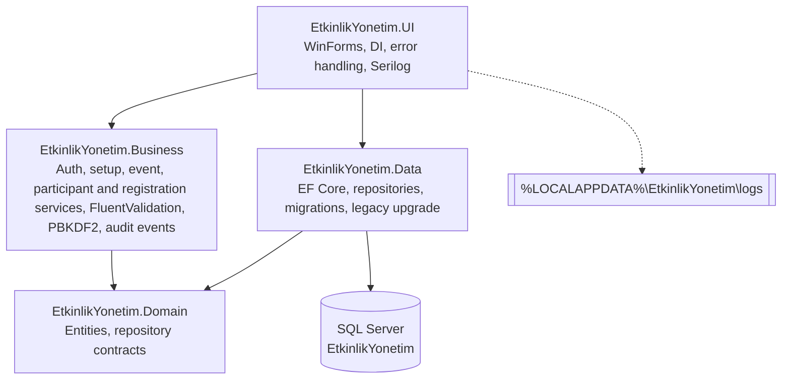

# 🎉 Etkinlik Yönetim - Etkinlik Yönetim Sistemi (C# & SQL Server)

🇬🇧 [English](README.md) · 🇹🇷 **Türkçe**

.NET 10 ve SQL Server ile geliştirilmiş, etkinlik organizasyonu için bir Windows Forms uygulaması: hesaplar kayıt
olup giriş yapar, getirdikleri katılımcıları ekler, onları etkinliklere kaydeder (ya da dolu bir etkinliğin bekleme
listesine alınır) ve her yer için QR kodlu bir bilet alır; yöneticiler etkinlik oluşturur, değiştirir ve iptal eder,
girişte biletleri kontrol eder, bir etkinliğin katılımcılarını listeler ve dışa aktarır, hesapları yönetir. Kod Domain,
Business, Data ve UI katmanlarına ayrılmıştır; veritabanı erişimi EF Core ile yapılır ve veritabanı açılışta
otomatik olarak oluşturulup güncellenir.

> Uygulamanın arayüzü Türkçedir. Aşağıda ekran ve düğme adları, Türkçe etiketin ardından İngilizce karşılığıyla
> verilir; örneğin "Etkinlik Ekle" (Add Event).

---

## 📦 Özellikler

### Hesaplar

- ✅ **Kayıt** ("Kayıt Ol", Sign Up): yalnızca harflerden oluşan bir kullanıcı adı (en fazla 32 karakter) ve iki kez
  yazılan ("Şifre (Tekrar)", Password (Again)) 8-64 karakterlik bir şifre. Yeni hesaplar kullanıcı rolü alır.
- ✅ **Giriş** ("Giriş", Sign In): kullanıcı adı ve şifreyle ("Kullanıcı Adı", "Şifre"). Yöneticiler yönetim
  panelini, kullanıcılar katılımcı ekranını açar.
- ✅ **İlk kurulum** ("İlk Kurulum", First-Run Setup): boş bir veritabanında ilk yönetici, kurulumu yapan kişinin
  kendi belirlediği şifreyle oluşturulur; varsayılan hesap ve yayımlanmış şifre yoktur.

### Kullanıcı paneli

- ✅ **Katılımcı ekleme** ("Katılımcı Ekle", Add Participant): T.C. Kimlik No ("TC Kimlik No"), ad soyad ("Ad Soyad")
  ve e-posta ("E-posta"). Kimlik numarası 11 hane ve kontrol basamaklarıyla doğrulanır; ad yalnızca harf ve tek
  boşluk içerebilir (en fazla 64 karakter). Katılımcı, onu ekleyen hesaba aittir ve bir kimlik numarası her hesapta
  yalnızca bir kez eklenebilir.
- ✅ **Etkinliğe kayıt** ("Kayıt Ekle", Add Registration): tarihi geçmemiş bir etkinlik seçilir ("Etkinlik Seçimi",
  Event Selection) ve katılımcının kimlik numarası girilir ("Katılımcı TC Kimlik Numarası"). Her yerle 130 rastgele
  bitlik bir bilet kodu (`ETK-` ve 26 karakter) üretilir. Bir katılımcı birden fazla etkinliğe kaydedilebilir.
- ✅ **Bekleme listesi**: etkinlik doluysa katılımcı reddedilmez, sıra numarasıyla bekleme listesine alınır. Bir
  yer iptal edildiğinde sıradaki katılımcı hemen o yere geçer ve bileti oluşturulur.
- ✅ **Kayıtlarım ve biletlerim** ("Kayıtlarım ve Biletlerim", My Registrations and Tickets): hesabın kendi
  katılımcılarının yerleri ve bekleme sıraları ile etkinliği iptal edildiği için kapanan kayıtlar ("Etkinlik iptal
  edildi"). Yerler ve bekleme sıraları etkinlik günü dahil iptal edilebilir ("Kaydı İptal Et", Cancel Registration).
- ✅ **Bileti göster** ("Bileti Göster", Show Ticket): bir yerin QR kodu ve bilet kodu, istendiği kadar.

### Yönetim paneli

- ✅ **Etkinlik oluşturma** ("Etkinlik Ekle", Add Event): ad ("Etkinlik Adı", en fazla 80 karakter), tarih (bugün
  veya sonrası) ve kapasite ("Kişi Kapasitesi", 1-1000 kişi).
- ✅ **Etkinlik yönetimi** ("Etkinlik Yönetimi", Event Management): günü geçmemiş bir etkinliğin tarihi, kapasitesi
  ve açıklaması değiştirilir; kapasite mevcut kayıt sayısının altına inemez, eklenen yerler bekleme listesine
  verilir. Etkinliği iptal etmek ("Etkinliği İptal Et", Cancel Event) onu iptal edildi olarak listede tutar, kayıtlarını
  ve bekleme sıralarını kapatır (soft delete).
- ✅ **Katılımcı ekleme** ("Katılımcı Ekleme") ve tüm hesapların katılımcıları için **bilet oluşturma** ("Bilet
  Oluştur", Create Ticket); yönetici tüm kayıtları görür ve iptal edebilir, bilet kodlarını ise yalnızca kendi
  eklediği katılımcıların görür.
- ✅ **Giriş kontrolü** ("Bilet Kontrol", Ticket Check): etkinlik seçilir, bilet kodu yazılır veya okutulur. Geçerli
  ve kullanılmamış bilet için "GİRİŞ YAPILDI", ikinci okutmada aynı ekranda "ZATEN KULLANILDI" gösterilir; bilinmeyen,
  iptal edilmiş ya da başka etkinliğe ait biletler tek bir retle ("GEÇERSİZ BİLET") karşılanır; sayaç girişleri yer
  sayısıyla birlikte gösterir.
- ✅ **Katılımcı listesi** ("Katılımcı Görüntüle", View Participants): seçilen etkinliğin ("Etkinlik Seçin", Select
  Event) katılımcıları; ad, maskelenmiş kimlik numarası, e-posta ve durumla (giriş yaptı, bekliyor, iptal). Liste CSV
  ("CSV Olarak Kaydet") veya yazdırılabilir HTML ("Yazdırılabilir Liste") olarak kaydedilir; dışa aktarımlarda bilet
  kodu yoktur.
- ✅ **Hesaplar** ("Kullanıcılar", Users): hesaplar etkinleştirilir, devre dışı bırakılır, yönetici veya kullanıcı
  yapılır. Yönetici kendi hesabını değiştiremez; son etkin yönetici korunur.

### Kurallar ve koruma

- ✅ **Kapasite**: bir etkinlik kapasitesinden fazla kayıt almaz; yer sayısı aynı veritabanı işleminde, etkinlik
  başına bir uygulama kilidi altında kontrol edilip artırılır, bu yüzden eşzamanlı kayıtlar, iptaller ve kapasite
  değişiklikleri kontenjanı aşamaz ve kimse bekleme listesinin önüne geçemez.
- ✅ **Çift kayıt yok**: bir katılımcının bir etkinlikte en fazla bir yeri veya bekleme sırası olur (benzersiz
  indeks); iptal edilen kayıt geçmiş olarak kalır.
- ✅ **Geçmiş etkinlik yok**: günü geçmiş bir etkinlik oluşturulamaz, ona kayıt yapılamaz ve kaydı iptal edilemez.
- ✅ **KVKK**: kimlik numaraları yönetim listelerinde maskelenmiş gösterilir (`123******01`) ve log dosyalarına asla
  yazılmaz; ad ve e-posta adresleri yöneticinin katılımcı listesinde açık gösterilir.

### Güvenlik

- ✅ Şifreler PBKDF2-HMAC-SHA256 özetleri olarak saklanır (600.000 iterasyon, rastgele tuz); özgün uygulamanın düz
  metin şifreleri bir sonraki başarılı girişte özetle değiştirilir.
- ✅ 5 hatalı giriş hesabı 15 dakika kilitler; bilinmeyen hesap, yanlış şifre ve kilitli hesap aynı yanıtı alır.
- ✅ Her çağrı oturum açmış hesaba, oturum da veritabanına göre denetlenir: rolü düşürülen, devre dışı bırakılan
  veya silinen bir hesap hâlâ açık olan bir pencereyi kullanamaz. Kullanıcılar yalnızca kendi katılımcılarına ve
  kayıtlarına erişir; olmayan bir kayıt ile başkasının kaydı aynı yanıtı alır.
- ✅ Bilet kodları SHA-256 özetleriyle bulunduktan sonra sabit zamanda karşılaştırılır; loga ve dışa aktarımlara asla
  yazılmaz.
- ✅ Türkçe mesajlı merkezi FluentValidation doğrulayıcıları; yazma düğmeleri bir işlem sürerken tekrarlanan
  tıklamaları yok sayar.
- ✅ Kişisel veri içermeyen, anonim denetim kodlarıyla günlük log dosyaları; bir hesabın, kaydın veya biletin var olup
  olmadığını belli edecek sonuçlar tek bir nötr kodu paylaşır.

---

## 🖼️ Ekran Görüntüleri

Bu görüntüler özgün uygulamanın ekranlarını gösterir; tasarım güncellemesiyle değiştirilecektir.

### Giriş ("Giriş Yap")


### Kayıt ("Kayıt Ol")


### Etkinliğe kayıt ("Kayıt Ekle")


### Yönetim paneli ("Yönetim Paneli")


### Katılımcı listesi ("Katılımcı Görüntüle")


---

## 🔑 Yetki Matrisi

| İşlem | Kullanıcı | Yönetici |
|---|---|---|
| Hesap oluşturma | ✅ (giriş ekranından, kullanıcı rolü) | ❌ (ilk yönetici kurulumdan gelir) |
| Giriş | ✅ | ✅ |
| Etkinlikleri listeleme | ✅ | ✅ |
| Etkinlik oluşturma | ❌ | ✅ |
| Etkinliği değiştirme veya iptal etme (geçmemiş) | ❌ | ✅ |
| Katılımcı ekleme | ✅ kendi hesabına ait | ✅ kendi hesabına ait |
| Katılımcıyı etkinliğe (veya bekleme listesine) kaydetme | ✅ yalnızca kendi katılımcıları | ✅ her katılımcı |
| Kayıtları ve bekleme sıralarını listeleme | ✅ kendi katılımcılarının | ✅ tümü |
| Bilet kodunu ve QR kodunu görme | ✅ kendi katılımcılarının | ✅ kendi eklediği katılımcıların |
| Kayıt veya bekleme sırası iptali | ✅ kendi kaydı, etkinlik gününe kadar | ✅ her kayıt, etkinlik gününe kadar |
| Bir etkinliğin katılımcılarını listeleme (maskeli kimlik no) | ❌ | ✅ |
| Katılımcı listesini dışa aktarma (CSV, HTML; bilet kodu yok) | ❌ | ✅ |
| Girişte bilet kontrolü | ❌ | ✅ |
| Başka bir hesabı etkinleştirme, devre dışı bırakma veya rolünü değiştirme | ❌ (kendi hesabı da dahil) | ✅ (kendi hesabı hariç; son etkin yönetici kalır) |
| İlk yöneticiyi oluşturma | ❌ (yalnızca boş veritabanında veya sahibin kurulum anahtarıyla) | - |

---

## 🧰 Teknolojiler

| Alan | Kullanılan |
|---|---|
| Platform | .NET 10 (`net10.0-windows` arayüz, `net10.0` kütüphaneler) |
| Arayüz | Windows Forms |
| Veri erişimi | Entity Framework Core 10 (SQL Server sağlayıcısı) |
| Veritabanı | Microsoft SQL Server (Express yeterli) |
| Şifre özeti | PBKDF2-HMAC-SHA256 (`Rfc2898DeriveBytes.Pbkdf2`) |
| Doğrulama | FluentValidation |
| QR kodları | QRCoder 1.6.0 (MIT) |
| Yapılandırma / DI | Microsoft.Extensions.Configuration (JSON, user secrets, ortam değişkenleri), Microsoft.Extensions.DependencyInjection |
| Loglama | Serilog (dosya, günlük dönüşüm) |
| Test | xUnit v3, Moq, EF Core SQLite (bellek içi), gerçek SQL Server testleri |
| CI | GitHub Actions (`.github/workflows/ci.yml`) |

---

## 🗂️ Proje Yapısı

```text
EtkinlikYonetim/
├── src/
│   ├── EtkinlikYonetim.Domain/     # Varlıklar (User, Event, Participant, Registration, SetupKey) ve depo sözleşmeleri
│   ├── EtkinlikYonetim.Business/   # Giriş, kurulum, hesap, etkinlik, katılımcı, kayıt ve giriş kontrolü servisleri, Exports/ (CSV, HTML), Security/ (PBKDF2, kilitleme, kurulum anahtarı), Validation/ (FluentValidation), Auditing/
│   ├── EtkinlikYonetim.Data/       # EF Core DbContext, yapılandırmalar, Migrations/, eski şema yükseltmesi, demo verisi, depolar
│   └── EtkinlikYonetim.UI/         # WinForms ekranları, Infrastructure/ (hatalar, loglama, iletişim kutuları, yazma koruması, oturum sonu, QR kodu, dışa aktarım dosyaları), Program.cs (kompozisyon kökü)
├── tests/
│   ├── EtkinlikYonetim.Business.Tests/  # Doğrulayıcılar, kimlik no, şifre özeti, kilitleme, kapasite, tarihler ve sahiplik (Moq)
│   ├── EtkinlikYonetim.Data.Tests/      # SQLite üzerinde servisler; SQL Server'da yarışlar, kurulum anahtarları ve eski şema yükseltmesi
│   └── EtkinlikYonetim.UI.Tests/        # Yapılandırma, hatalar, loglar, odak ve yazma korumaları (pencere gösterilmez)
├── assets/                         # Özgün logo, arka plan ve simge ile SVG kaynakları
├── docs/
│   ├── issue-setup-key.sql         # Kurulum anahtarı, veritabanı sahibi çalıştırır
│   ├── grant-app-login.sql         # Uygulamanın kendi oturumunun yetkileri
│   └── THREAT_MODEL.md             # Tehdit modeli (İngilizce)
├── screenshots/
├── .github/workflows/ci.yml        # Derleme, test, SQL Server ve sürüm iş akışı
├── CHANGELOG.md
└── EtkinlikYonetim.sln
```



Arayüz, Data katmanına yalnızca açılışta bağımlılıkları kaydetmek için başvurur; formlar her çağrıda oturumu alan
Business servisleri üzerinden çalışır. Tüm veritabanı erişimi asenkron ve parametrelidir. Sağlayıcı DI ile
yapılandırılır (`AddDataAccess`), böylece testler bellek içi SQLite kullanabilir.

---

## 🛠️ Kurulum ve Kullanım

### Gereksinimler

- .NET 10 SDK (Windows)
- SQL Server (Express yeterli)

```powershell
git clone https://github.com/ayberkaarda/EtkinlikYonetim.git
cd EtkinlikYonetim
dotnet build -c Release
```

### 1. Yapılandırma

`EtkinlikYonetim` adlı bir bağlantı dizesi verin. Aşağıdakilerden herhangi biri olur (sonrakiler öncekileri ezer):

1. **`appsettings.json`**: `src/EtkinlikYonetim.UI/appsettings.example.json` dosyasını aynı klasöre
   `appsettings.json` adıyla kopyalayıp `ConnectionStrings:EtkinlikYonetim` değerini düzenleyin. `appsettings.json`
   git'e eklenmez.

   ```json
   {
     "ConnectionStrings": {
       "EtkinlikYonetim": "Server=localhost\\SQLEXPRESS;Database=EtkinlikYonetim;Trusted_Connection=True;TrustServerCertificate=True;"
     },
     "Seed": {
       "Demo": false
     }
   }
   ```

2. **User secrets**:

   ```powershell
   dotnet user-secrets set "ConnectionStrings:EtkinlikYonetim" "<bağlantı dizesi>" --project src/EtkinlikYonetim.UI
   ```

3. **Ortam değişkeni** `ConnectionStrings__EtkinlikYonetim`.
4. **Ortam değişkeni** `ETKINLIK_CONNECTION` (en yüksek öncelik).

> JSON içinde `localhost\SQLEXPRESS` ifadesindeki `\` karakteri `\\` olarak yazılır. `TrustServerCertificate=True`
> yalnızca yerel geliştirme sunucusu içindir.

Bağlantı dizesi bulunamazsa uygulama bu seçenekleri anlatan Türkçe bir mesaj gösterip kapanır.

### 2. Çalıştırma

```powershell
dotnet run --project src/EtkinlikYonetim.UI
```

Tabloları elle oluşturmanız gerekmez: veritabanı ilk açılışta oluşturulur ve bekleyen EF Core migration'ları her
açılışta otomatik uygulanır; elle `dotnet ef database update` çalıştırmak veya `.bak` dosyası gerekmez.

### 3. İlk kurulum

- **Boş veritabanı (hiç hesap yok):** varsayılan kurulum hiçbir hesap oluşturmaz ve hiçbir hazır şifre içermez.
  **"İlk Kurulum"** ekranı açılır ve ilk yönetici hesabını kendi belirlediğiniz şifreyle oluşturursunuz. Anahtar
  gerekmez. Kurulumu kapatmak uygulamayı sonlandırır.
- **Hesapları olan ama yöneticisi olmayan veritabanı** (örneğin yükseltilmiş eski bir veritabanı): uygulama normal
  giriş ekranıyla açılır; yönetici yokluğu tek başına kimseye yetki vermez. İlk yönetici yalnızca **kurulum
  anahtarı** ile oluşturulur: giriş ekranındaki **"İlk yönetici hesabını oluştur"** bağlantısı kurulum formunu açar
  ve anahtarı ister.
- Anahtarı uygulama üretmez; yalnızca **veritabanı sahibi** (db_owner veya sysadmin) `docs/issue-setup-key.sql`
  betiğini uygulamanın veritabanına bağlanarak çalıştırır, örneğin
  `sqlcmd -S <sunucu> -d <veritabanı> -E -i docs\issue-setup-key.sql`. Betik 16 rastgele bayttan (128 bit,
  `CRYPT_GEN_RANDOM`) 32 onaltılık karakterlik anahtarı üretir, `KurulumAnahtarlari` tablosuna yalnızca SHA-256
  özetini yazar ve anahtarı bir kez gösterir. Anahtarı kurucuya güvenli bir yoldan iletin; başka hiçbir yerde
  saklanmaz ve uygulama onu loglamaz.
- Betik, veritabanında yönetici hesabı varsa anahtar üretmeyi reddeder. Kaybolan veya başkasına görünen
  kullanılmamış anahtarları iptal etmek için betikteki `@RevokeUnusedKeys` değerini `1` yapıp yeniden çalıştırın.
- Uygulamanın kendi oturumu için `docs/grant-app-login.sql` örnek yetkileri verir: anahtar tablosunda yalnızca okuma
  (`SELECT`) ve kullanıldı işareti (`Tuketildi`, `TuketimTarihi` sütunlarında `UPDATE`); anahtar ekleme, silme, özet
  veya son kullanma tarihini değiştirme yetkisi yoktur. Diğer tablolarda okuyabilir, ekleyebilir ve
  güncelleyebilir, ama silemez. İlk açılışı (şema oluşturma/yükseltme) veritabanı sahibinin bağlantısıyla yapın,
  ardından uygulamanın bağlantı ayarını bu oturuma çevirin.
- Anahtarı formdaki **"Kurulum Anahtarı"** alanına yazın (tireler, boşluklar ve büyük/küçük harf önemli değildir) ya
  da `ETKINLIK_SETUP_KEY` ortam değişkeniyle verin; ortam değişkeni yalnızca alanı doldurur ve geçerli anahtar
  biçiminde değilse alanı boş bırakıp uyarır. Değer her durumda veritabanındaki kayıtla doğrulanır; istemcide
  seçilen veya üretilen bir değer yetki sayılmaz.
- Anahtar 24 saat geçerlidir ve tek kullanımlıktır: yönetici hesabını yazan işlemle birlikte veritabanında
  kullanıldı olarak işaretlenir, bu nedenle başka bir profil veya bilgisayardan yeniden kullanılamaz; yazma başarısız
  olursa anahtar harcanmaz. Süre, anahtarın kullanıldığı anda bilgisayarın değil veritabanının saatine göre
  belirlenir. Yönetici hesabı oluştuktan sonra kullanılmamış anahtarlar da kabul edilmez. Hatalı denemeler sayılmaz
  ve anahtarı iptal etmez (128 bitlik anahtar tahmin edilemez); her hatalı denemeden sonra 1 saniye beklenir.

### 4. Demo modu

Demo modu isteğe bağlıdır ve varsayılan olarak kapalıdır. `ETKINLIK_DEMO=1` (veya `true`) ortam değişkeni ya da
`appsettings.json` içinde `"Seed": { "Demo": true }` yalnızca tamamen boş bir veritabanına kurgusal örnek veriler
ekler. Yalnızca demo modu açıksa şu hesaplar oluşur:

| Rol | Kullanıcı adı (yalnızca demo modu) | Şifre (yalnızca demo modu) |
|---|---|---|
| Yönetici | `admin` | `Demo.Admin1` |
| Kullanıcı | `ornek` | `Demo.Kullanici1` |

Demo modunu gerçek bir kurulumda açmayın.

### 5. Eski veritabanını yükseltme

Özgün uygulamanın oluşturduğu bir veritabanı (migration geçmişi olmayan `Kullanicilar`, `Etkinlikler` ve
`Katilimcilar` tabloları) ilk açılışta verileri korunarak yerinde yükseltilir: mevcut satırlar, kimlik değerleri ve
düz metin şifreler korunur; şifreler eski düz metin olarak işaretlenir ve her hesabın bir sonraki başarılı girişinde
özetlenir. Özgün uygulamada adıyla saklanan katılımcının tek etkinliği biletli etkin bir kayda dönüşür ve
etkinliklerin yer sayaçları doldurulur. Yükseltme tek bir işlemde, bir uygulama kilidi (`sp_getapplock`) altında
çalışır ve tekrarlanması güvenlidir. Mevcut satırlar yeni kurallara uymuyorsa hiçbir şeyi değiştirmeden durur;
uygulama genel bir hata mesajı gösterir, log dosyasına ise hata yalnızca istisna türleri ve sayısal hata kodlarıyla,
satırlar ve içerikleri olmadan yazılır.

Yeni sürümle ilk açılıştan önce veritabanının yedeğini alın ve yedeği koruyun: hâlâ düz metin şifreleri içerir.

### 6. Migration'lar

```powershell
dotnet tool restore
dotnet ef migrations list --project src/EtkinlikYonetim.Data
dotnet ef migrations add <Ad> --project src/EtkinlikYonetim.Data --output-dir Persistence/Migrations
```

Tasarım zamanı fabrikası `ETKINLIK_CONNECTION` değişkenini okur, yoksa yerel SQL Server Express örneğini kullanır.
Yeni migration'ları veritabanı sahibinin bağlantısıyla uygulayın; uygulamanın kısıtlı oturumunun DDL yetkisi yoktur.

> **Geri alma notu:** `ScopeNationalIdToOwner` migration'ı kayıpsız geri alınamaz. Farklı hesaplarda aynı T.C.
> Kimlik numarasına sahip katılımcı varsa geri alma hiçbir şeyi değiştirmeden durur; bu satırları önce elle çözün.

### 7. Loglar

Loglar `%LOCALAPPDATA%\EtkinlikYonetim\logs` altına, her gün için bir dosya olarak yazılır. 30 günden eski dosyalar
silinir ve en fazla 30 dosya tutulur. Klasör deponun dışındadır. Hata kayıtları yalnızca istisna türlerini, HResult
kodlarını ve yığın izindeki metot adlarını içerir (dosya yolu yok); reddedilen işlemler kendi başına bir satır
yazmaz. Denetim kayıtları yalnızca sabit bir kod ve bir roldür, asla bir hesap değildir; her başarısız giriş
(bilinmeyen hesap, yanlış şifre, kilitli veya devre dışı hesap) aynı kodu yazar: `auth.sign_in.failed`. Bir hesabın,
kaydın veya biletin var olup olmadığını belli edecek sonuçlar tek bir kodu paylaşır: kayıt olma için
`auth.account.registration_submitted`, etkinlik kaydı için `registration.submitted`, iptal için
`registration.cancel_submitted` ve girişte okutma için `ticket.check_in_submitted`.

Adlar, e-posta adresleri, kimlik numaraları, şifreler, kurulum anahtarları, bilet kodları ve istisna mesajları loga
asla yazılmaz.

---

## 🔐 Güvenlik

Tehdit modeli için [docs/THREAT_MODEL.md](docs/THREAT_MODEL.md) dosyasına bakın.

- Kimlik numaraları, adlar ve e-posta adresleri kişisel veridir (KVKK). Yalnızca yapılandırılan SQL Server
  veritabanında saklanır ve log dosyalarına asla yazılmaz. Kimlik numaraları yönetim listelerinde maskelenmiş
  gösterilir; ad ve e-posta adresleri yöneticinin katılımcı listesinde açık gösterilir.
- Şifreler PBKDF2 ile özetlenir; saklama biçimi ayrı bir sütunda tutulur, bu yüzden bir değer asla başka bir
  biçimde okunmaz.
- Kilitleme sayaçları atomik olarak güncellenir ve başarılı giriş yalnızca hesap hâlâ kilitli değilken yazılır;
  eşzamanlı denemeler yeni bir kilidi kaldıramaz.
- Sahiplik servislerde denetlenir ve veritabanı komutlarında tekrarlanır.
- Açık bir oturumun her işlemi önce hesabın rolünü ve etkinlik durumunu veritabanından okur; hesap değişiklikleri
  işlemi yapan yöneticiyi kendi işlemlerinin içinde yeniden denetler.
- Bilet kodları 130 rastgele bittir. Katılımcının hesabı QR kodu yeniden gösterebilsin diye olduğu gibi, SHA-256
  özetiyle birlikte saklanır: giriş bileti özetle bulur ve kodu sabit zamanda karşılaştırır. Yönetim listeleri ve
  dışa aktarımlar kodu asla göstermez.
- Bağlantı dizeleri depo dışında tutulur (`appsettings.json` yok sayılır; user secrets ve ortam değişkenleri
  desteklenir). Tüm sorgular parametrelerle EF Core üzerinden gider.
- Kullanıcılar yalnızca Türkçe mesajlar görür; ham istisna metni asla gösterilmez.
- **Güvenlik notu:** Bu sürümden önceki ara sürümlerle kurulmuş veritabanlarında `admin` ve `ornek` örnek hesapları,
  yukarıda yayımlanmış şifreleriyle bulunabilir. Böyle bir veritabanında bu hesapları (sahip oldukları örnek
  katılımcı ve kayıtlarla birlikte) silin ya da şifrelerini değiştirin. Hiç yönetici hesabı kalmazsa yeni yönetici,
  giriş ekranından veritabanı sahibinin ürettiği kurulum anahtarıyla oluşturulur.

---

## 🧪 Testler

```powershell
dotnet test -c Release
```

| Proje | Tür | Kapsam |
|---|---|---|
| `tests/EtkinlikYonetim.Business.Tests` | Birim | Doğrulayıcı sınırları (kullanıcı adı 32, şifre 8/64 ve girişte 100, ad 64, etkinlik adı 80, kapasite 0/1/1000/1001, açıklama 500, geçmiş tarihler), kimlik no kontrol basamakları, PBKDF2 ve biçim yükseltmesi, kilitleme, kurulum anahtarı denetimleri, veritabanıyla denetlenen oturumlar, hesap kuralları, bilet kodları ve giriş sonuçları, CSV ve HTML dışa aktarımı, sıkı Moq nesneleriyle sahiplik ve denetim olayları |
| `tests/EtkinlikYonetim.Data.Tests` | Entegrasyon | Bellek içi SQLite üzerinde servisler ve depolar (kapasite sınırları, bekleme listesi sırası, iptal ve yeniden kayıt, etkinlik değişikliği ve iptali, giriş kontrolü, dışa aktarım, rolü düşürülen ve devre dışı oturumlar, IDOR yanıtları, kilit süresi); SQL Server'da kapasite, bekleme listesi, çift kayıt, giriş, hesap, kilitleme ve ilk yönetici yarışları, kısıtlı oturumla kurulum anahtarları, migration'lar, eski şema yükseltmesi ve kilidi |
| `tests/EtkinlikYonetim.UI.Tests` | Birim | Örnek yapılandırma, hata mesajları, log içeriği, nötr kodlar ve saklama süresi, kilit açıldıktan sonra odak, yazma korumaları, en son isteğin kazandığı yüklemeler, etkinlik yönetimi, giriş kontrolü ve hesap pencereleri, bilet QR görünümü, dışa aktarım dosyaları, oturum sonu, nötr marka |

SQL Server testleri `ETKINLIK_TEST_SQLSERVER` içindeki sunucuda geçici veritabanları kullanır (varsayılan: Windows
kimlik doğrulamasıyla yerel SQL Express). `ETKINLIK_SKIP_SQL_TESTS=1` tanımlıysa veya sunucuya ulaşılamıyorsa
atlanır; `ETKINLIK_REQUIRE_SQL_TESTS=1` ile (CI'daki SQL Server işi) ulaşılamayan sunucu testleri atlatmak yerine
başarısız kılar. Geçici veritabanları sonrasında silinir. Özgün veritabanının geri yüklenmiş yedeğiyle yapılan test
yalnızca `ETKINLIK_LEGACY_BACKUP`, SQL Server hizmetinin okuyabildiği bir `.bak` dosyasını gösterdiğinde çalışır.

```powershell
$env:ETKINLIK_SKIP_SQL_TESTS = "1"; dotnet test -c Release
```

SQLite üzerinde şema migration'lar yerine modelden oluşturulur. Arayüz testleri formları göstermeden oluşturur, tüm
mesaj kutularını değiştirir ve sırayla çalışır; hiçbir pencere açılmaz.

---

## 🚀 CI ve Sürüm

`.github/workflows/ci.yml`; `main` dalına gönderimlerde, pull request'lerde ve `v*` etiketlerinde çalışır:

1. **build-test** (Windows): `dotnet build -c Release` ve `dotnet test -c Release` (SQL Server testleri atlanır)
2. **sql-server** (Linux): veri testleri, geçici bir SQL Server konteynerine karşı `ETKINLIK_REQUIRE_SQL_TESTS=1`
   ile
3. **release** (yalnızca `v*` etiketlerinde): etiket adı bir ortam değişkeniyle aktarılır ve
   `^v[A-Za-z0-9._-]+$` ile denetlenir; ardından çatıya bağımlı bir win-x64 derlemesi yayımlanır ve
   `EtkinlikYonetim-<etiket>-win-x64.zip` iş akışı çıktısı olarak yüklenir

Aynı derlemeyi yerelde almak için:

```powershell
dotnet publish src/EtkinlikYonetim.UI -c Release -r win-x64 --self-contained false -o ./publish
```

Hedef makinede .NET 10 Desktop Runtime gerekir. `appsettings.json` dosyasını `EtkinlikYonetim.exe` yanına koyun ya
da `ETKINLIK_CONNECTION` tanımlayın.

---

## 👨‍💻 Geliştirici Notları

- Sürüm geçmişi için [CHANGELOG.tr.md](CHANGELOG.tr.md) dosyasına bakın.
- `Program.cs` kompozisyon köküdür: yapılandırma, DI, loglama, denetim kaydı ve genel `ThreadException` /
  `UnhandledException` işleyicileri orada kurulur.
- İş kuralı ihlalleri `BusinessRuleException`, sahiplik ihlalleri `AccessDeniedException` fırlatır; ikisi de
  arayüzün uyarı olarak gösterdiği sabit Türkçe mesajlar taşır.
- Doğrulayıcılar `EtkinlikYonetim.Business/Validation` altındadır ve ilk hatada durur; kullanıcı her seferinde tek
  bir mesaj görür.
- Yeni yazma düğmeleri `ExclusiveOperation` üzerinden çalışmalı ve odağı `FocusAfterUnlock` ile taşımalıdır; bir
  seçimle tetiklenen yüklemeler yalnızca en son yanıtın gösterilmesi için `RequestSequence` kullanmalıdır. Mesaj
  kutuları `Dialogs` veya `IUserPrompts` üzerinden açılır, asla doğrudan `MessageBox` ile değil.
- Denetim olayları yalnızca olay türünü ve rolü taşır; onlara kimlik belirleyen veri eklemeyin.

---

## 📧 İletişim

Proje hakkında sorularınız için benimle iletişime geçebilirsiniz.
